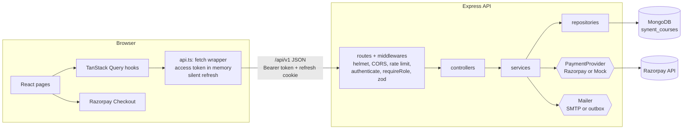

# Kalam: online course platform

Full-stack course platform where learners enrol in video courses, pay with Razorpay (test mode)
and track their progress lesson by lesson, while admins manage courses, modules and lessons.
Built for the **Synent Technologies web development internship, Task 8: Online Course Platform
(Full Stack)**.

> Kalam ("pen" in Hindi and Urdu) is invented for this exercise. Courses, instructors and prices
> are illustrative.

## Features, mapped to the brief

| Brief section | What is implemented |
|---|---|
| 1. Authentication | Registration and login, JWT access token (15 min, kept in memory) plus rotating refresh token in an httpOnly cookie with reuse detection, email verification, forgot and reset password with single-use hashed tokens, `user` and `admin` roles |
| 2. User dashboard | Catalogue of published courses with title search, subject, level and free/paid filters, sorting and pagination (all in the URL); course page with description, price, modules and lessons, free previews; "My learning" dashboard with progress |
| 3. Enrolment flow | Course page → **Enroll now** → checkout → Razorpay Checkout (or a clearly labelled local test payment) → server-side signature, amount and capture checks → course in the dashboard. Free courses enrol in one click |
| 4. Learning system | Player for enrolled learners: modules → lessons sidebar, HTML5 `<video>` for MP4 files and privacy-enhanced `youtube-nocookie.com` embeds for YouTube, mark complete or not complete, progress in % |
| 5. Admin panel | Overview (learners, enrolments, revenue, published courses, latest payments); courses table with search, status filter, create, edit, delete with confirmation, publish/unpublish; content editor to add, edit, delete and reorder modules and lessons (title, video URL, duration, free preview); users with their enrolments; enrolments and payments filtered by course and status |
| 6. Data and notifications | Enrolments and payments stored in MongoDB; emails on registration (verification link) and on enrolment (receipt and course link) |

## Tech stack

| Layer | Tools |
|---|---|
| Client | React 19, Vite, TypeScript, Tailwind CSS v4, shadcn/ui (Radix), React Router, TanStack Query, react-hook-form + zod, sonner |
| Server | Node.js, Express 5, TypeScript, Mongoose 9, zod, jsonwebtoken, bcryptjs, helmet, cors, express-rate-limit, Nodemailer, Razorpay Node SDK, swagger-ui-express |
| Database | MongoDB (`synent_courses`) |
| Tests | Vitest, supertest, Testing Library, jsdom |

## Architecture



Details (data model, endpoints, token lifecycle, payment sequence, security measures, design
tokens) are in [`docs/SPECIFICATION.md`](docs/SPECIFICATION.md).

## Getting started

Requirements: Node.js 20 or later, npm 10 or later, and MongoDB 6 or later listening on
`mongodb://127.0.0.1:27017` (a local `mongod`, or `docker run -p 27017:27017 mongo:8`).

```bash
npm install
cp server/.env.example server/.env
# Set JWT_ACCESS_SECRET in server/.env, for example with:
node -e "console.log(require('crypto').randomBytes(48).toString('base64url'))"

npm run seed      # demo accounts and eight courses in the synent_courses database
npm run dev       # API on http://localhost:4100, client on http://localhost:5175
```

Open http://localhost:5175. The client proxies `/api` to the API, so the refresh cookie stays
first-party in development.

### Scripts (from the repository root)

| Command | What it does |
|---|---|
| `npm run dev` | Starts the API (tsx watch) and the client (Vite) together |
| `npm run seed` | Resets the demo accounts and the seeded courses (other data is kept) |
| `npm test` | Server tests (needs MongoDB, uses `synent_courses_test`), then client tests |
| `npm run typecheck` | TypeScript checks for both workspaces |
| `npm run build` | Compiles the API to `server/dist` and the client to `client/dist` |
| `npm start` | Runs the compiled API |

### Demo accounts

Created by `npm run seed`. These are test-only values from `server/.env.example`; change them
before any shared deployment.

| Role | Email | Password |
|---|---|---|
| Admin | `admin@kalam.test` | `41cJLCOUh1eS7a` |
| Learner (already enrolled in two courses) | `learner@kalam.test` | `odI3v10NxOps4b` |

Admins are only created by the seed script. Public registration always creates a learner.

## Environment variables (`server/.env`)

| Variable | Default | Purpose |
|---|---|---|
| `NODE_ENV` | `development` | `production` enables secure cookies and refuses the mock payment provider and the outbox mailer |
| `PORT` | `4100` | API port |
| `MONGODB_URI` | `mongodb://127.0.0.1:27017/synent_courses` | Database |
| `CLIENT_URL` | `http://localhost:5175` | Allowed CORS origin and base of links in emails |
| `JWT_ACCESS_SECRET` | required | HS256 secret, at least 32 characters |
| `ACCESS_TOKEN_TTL_SECONDS` | `900` | Access token lifetime |
| `REFRESH_TOKEN_TTL_DAYS` | `7` | Refresh token lifetime |
| `PAYMENT_PROVIDER` | `mock` | `razorpay` or `mock` |
| `RAZORPAY_KEY_ID`, `RAZORPAY_KEY_SECRET` | empty | Razorpay test keys (required when `PAYMENT_PROVIDER=razorpay`) |
| `RAZORPAY_WEBHOOK_SECRET` | empty | Optional, enables `POST /api/v1/payments/webhooks/razorpay` |
| `MOCK_PAYMENT_SECRET` | local value | Signs simulated payments of the mock provider |
| `MAIL_TRANSPORT` | `outbox` | `outbox` (development) or `smtp` |
| `MAIL_FROM`, `SMTP_HOST`, `SMTP_PORT`, `SMTP_SECURE`, `SMTP_USER`, `SMTP_PASS` | | SMTP settings |
| `RATE_LIMIT_DISABLED` | `false` | Test helper; refused in production |
| `SEED_ADMIN_EMAIL`, `SEED_ADMIN_PASSWORD`, `SEED_USER_EMAIL`, `SEED_USER_PASSWORD` | | Demo accounts for `npm run seed` |

The configuration is validated with zod at startup: the API refuses to start with a missing or
inconsistent value.

## Payments: Razorpay test mode

Without keys the API uses the **mock provider**: checkout opens a dialog labelled
"Test payment" and the API signs a simulated callback exactly like Razorpay, so the same
verification code runs. To use real Razorpay test mode:

1. Create a free account at https://dashboard.razorpay.com and switch the dashboard to
   **Test Mode**.
2. Go to **Account & Settings → API Keys** and generate a test key (`rzp_test_…`) and secret.
3. In `server/.env` set `PAYMENT_PROVIDER=razorpay`, `RAZORPAY_KEY_ID` and `RAZORPAY_KEY_SECRET`,
   then restart the API.
4. Pay with a Razorpay test card or test UPI ID from the Razorpay documentation
   ("Test card details").
5. Optional webhook: in **Webhooks**, point a webhook for `payment.captured` to
   `https://<your-api>/api/v1/payments/webhooks/razorpay` and copy its secret into
   `RAZORPAY_WEBHOOK_SECRET`. (For local testing use a tunnel such as ngrok.)

The amount always comes from the database, the signature is checked with a constant-time
comparison, the payment is re-read from Razorpay to confirm its order, amount and capture, and the
order is settled once (see section 8 of the specification).

## Email

In development (`MAIL_TRANSPORT=outbox`) every email is written as an HTML file in
`server/.mail-outbox/` (git-ignored) and its links are printed in the API log, so the verification
and reset links can be opened during a demo. In production set `MAIL_TRANSPORT=smtp` and the SMTP
variables (any provider: Brevo, Mailgun, SES, Gmail with an app password…); the API refuses the
outbox transport when `NODE_ENV=production`.

## API documentation

Swagger UI: http://localhost:4100/api/v1/docs, OpenAPI document: http://localhost:4100/api/v1/docs.json.
Request bodies and query parameters in the document are generated from the zod schemas that
validate the requests.

## Project structure

```
.
├── client/                         React application (Vite)
│   └── src/
│       ├── auth/                   AuthProvider, useAuth, route guards
│       ├── components/             Course cover, progress meter, player, header… (ui/ = shadcn)
│       ├── features/admin/         Admin data hooks, forms and table helpers
│       ├── hooks/                  TanStack Query hooks (catalogue, course, learning, enrolment)
│       ├── layouts/                Learner layout, admin layout (shadcn Sidebar)
│       ├── lib/                    API client, Razorpay loader, formatters, video parsing, types
│       ├── pages/                  Learner pages, auth/ and admin/ pages
│       └── router.tsx              Routes (admin panel lazy-loaded)
├── server/                         Express API
│   ├── src/
│   │   ├── config/env.ts           Validated configuration
│   │   ├── docs/                   OpenAPI document and Swagger UI
│   │   ├── lib/                    AppError, JWT, crypto, pagination, background tasks, logger
│   │   ├── mail/                   Mailer interface, outbox and SMTP transports, templates
│   │   ├── middlewares/            authenticate, requireRole, validate, rate limits, errors
│   │   ├── models/                 Mongoose models and indexes
│   │   ├── modules/                auth, users, courses, enrollments, payments, learning, admin
│   │   ├── payments/               PaymentProvider strategy: Razorpay and mock
│   │   └── scripts/                Seed script and data
│   └── tests/                      Vitest + supertest suites
└── docs/SPECIFICATION.md           Requirements, data model, API, security, design, testing
```

## Testing

```bash
npm test
```

The server suites run against the real Express app and the `synent_courses_test` database
(dropped before each run, with a guard that refuses any database not ending in `_test`). They
cover the auth flow, refresh rotation and reuse detection, RBAC, payment verification (valid,
invalid, tampered, not captured, replayed, concurrent), enrolment idempotency, progress and admin
content management. Client tests cover video parsing, formatting, token refresh, route guards and
the login form.

## Deployment notes

- **API**: any Node host (Render, Railway, Fly.io, a VM). Build with `npm run build -w server`,
  start with `npm start`, set `NODE_ENV=production`, a strong `JWT_ACCESS_SECRET`, `CLIENT_URL`,
  `MONGODB_URI` (for example MongoDB Atlas), Razorpay keys and SMTP. The app trusts one proxy in
  production for correct client IPs in rate limiting.
- **Client**: static hosting (Vercel, Netlify, Nginx). Build with `npm run build -w client` and
  serve `client/dist` with a fallback to `index.html`. Proxy `/api` to the API on the same site,
  so the `SameSite=Lax` refresh cookie keeps working (a different site would need
  `SameSite=None; Secure` and a CSRF token).
- Serve everything over HTTPS: the refresh cookie is `Secure` in production.

## Author

**Parfait Ahouanto**, [github.com/Parfait18](https://github.com/Parfait18)

## License

[MIT](LICENSE)
